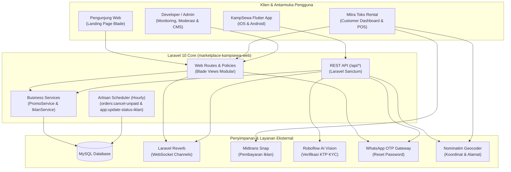

<div align="center">


# 🏕️ KampSewa Web & REST API

**Platform Marketplace Persewaan Alat Camping & Outdoor Berbasis Laravel 10, Blade, Live Chat Reverb, Midtrans & AI Computer Vision**

[](https://laravel.com/docs/10.x/blade)
[](https://laravel.com)
[](https://www.php.net)
[](https://laravel.com/docs/reverb)
[](https://midtrans.com)
[](https://roboflow.com)
[](https://tailwindcss.com)
[](https://www.mysql.com)
[](LICENSE)

[Tentang](#-tentang-kampsewa-web) •
[Ekosistem](#-ekosistem-kampsewa) •
[Arsitektur](#-arsitektur-platform) •
[Fitur Multi-Role](#-fitur-lengkap-berdasarkan-peran) •
[Automasi & AI](#-otomasi-sistem--integrasi-ai) •
[Tech Stack](#-tech-stack--dependensi) •
[Instalasi](#-panduan-instalasi--menjalankan) •
[Lisensi](#-lisensi)

</div>

---

## 📖 Tentang KampSewa Web

**KampSewa Web** adalah tulang punggung (*core platform*) dari ekosistem marketplace persewaan perlengkapan camping dan kegiatan luar ruangan **KampSewa**. Aplikasi ini menggabungkan **4 pilar utama** dalam satu codebase **Laravel 10**:

1. **Etalase Publik (Landing Page):** Pengenalan platform, katalog barang sewa, destinasi wisata alam, testimoni pengguna, dan profil perusahaan.
2. **Portal Mitra Toko (Customer Dashboard):** Manajemen inventaris & varian, **Kasir Offline (POS)**, alur penyewaan & denda, promo diskon toko, pengaturan biaya antar, pengajuan iklan **Midtrans Snap**, chat admin, dan laporan keuangan PDF.
3. **Panel Administrator (Developer Dashboard):** Analitik menyeluruh platform, manajemen pengguna & admin, **moderasi produk & iklan (suspend/pemulihan)**, CMS artikel wisata & berita, live chat & feedback WebSocket, serta rekap keuangan platform (Export/Import CSV).
4. **REST API (`auth:sanctum`):** Layanan API terpadu untuk aplikasi mobile [**KampSewa App (Flutter)**](https://github.com/dersterngreifer/marketplace-kampsewa-app), lengkap dengan **AI Deteksi KTP Roboflow**, **Watermark Otomatis Bukti Jaminan**, **OTP WhatsApp**, **Live Chat**, dan **Notifikasi In-App**.

---

## 🌐 Ekosistem KampSewa

| Repositori | Peran | Teknologi Utama |
|---|---|---|
| 🌐 [`marketplace-kampsewa-web`](https://github.com/dersterngreifer/marketplace-kampsewa-web) | **Landing Page, Portal Mitra, Admin Panel & REST API** *(repo ini)* | Laravel 10, Blade, Sanctum, Reverb, Midtrans, DomPDF, Roboflow |
| 📱 [`marketplace-kampsewa-app`](https://github.com/dersterngreifer/marketplace-kampsewa-app) | **Aplikasi Mobile Penyewa & Mitra (Android / iOS)** | Flutter, Dart, GetX, Dio, SQLite (`sqflite`) |
| 💬 [`marketplace-kampsewa-wa-gateway`](https://github.com/dersterngreifer/marketplace-kampsewa-wa-gateway) | **Gateway Pengiriman OTP WhatsApp** | Node.js HTTP Server (`localhost:3000/api/send-otp`) |

---

## 🏗️ Arsitektur Platform



---

## ✨ Fitur Lengkap Berdasarkan Peran

### 🌍 1. Halaman Publik (`LandingPageController`)
- **Beranda Dinamis:** Menampilkan konten dinamis (`LandingPageContent`), statistik marketplace langsung dari database, kategori peralatan populer (`KategoriProduk`), dan deretan **Toko Populer** (`TokoPopuler`).
- **Katalog Sewa Barang & Destinasi Wisata:** Eksplorasi peralatan outdoor dan rekomendasi lokasi camping/pendakian.
- **Testimoni & Tentang Kami:** Menampilkan ulasan pengguna beserta form pengiriman testimoni baru secara publik.

### 🏪 2. Portal Mitra Toko (`Customer`)
- **Dashboard Analitik Mitra:** Grafik perbandingan pemasukan tahunan dan bulanan, 5 peralatan paling laris disewa, daftar penyewa aktif, tagihan denda tertunda, pesanan baru (*Pending*), serta notifikasi status iklan yang ditangguhkan atau diselesaikan paksa.
- **Manajemen Produk & Varian:** Kelola etalase produk lengkap dengan multi-foto (`FotoProduk`), kategori, varian warna & ukuran (`VariantProduk`, `DetailVariantProduk`), stok, dan harga harian.
- **Kasir Offline (POS — `KasirOfflineController`):** Pencatatan transaksi sewa langsung di toko fisik (*walk-in customer*) dengan sinkronisasi otomatis ke stok varian dan riwayat penyewaan.
- **Siklus Order Lengkap (`TransaksiMenuController`):**
  1. **Order Masuk:** Verifikasi bukti transfer atau input pembayaran COD.
  2. **Pengambilan:** Serah terima barang sewa.
  3. **Sewa Berlangsung:** Pantauan sewa aktif.
  4. **Pengembalian & Denda:** Proses pengembalian alat, kalkulasi denda keterlambatan/kerusakan, pelunasan denda, serta pengembalian stok (`restoreStok`).
  5. **Order Selesai:** Arsip transaksi lengkap & pencatatan pemasukan.
- **Manajemen Promo & Diskon (`PromoController` & `PromoService`):** Buat promo seluruh toko maupun produk tertentu dengan resolusi konflik diskon otomatis.
- **Pengaturan Pengiriman (`PengirimanController`):** Konfigurasi opsi ambil di tempat & tarif biaya antar milik toko.
- **Iklan & Midtrans Snap (`IklanController`):** Pembuatan kampanye iklan banner beranda beserta pembayaran digital otomatis via **Midtrans Snap** (Virtual Account, QRIS, e-Wallet, dll.).
- **Keuangan Mitra & PDF (`KeuanganController`):** Pencatatan pemasukan dan pengeluaran toko dengan fitur **unduh laporan keuangan PDF** melalui **DomPDF**.
- **Live Chat Admin (`ChatAdminController`):** Komunikasi langsung antara mitra dan tim admin.

### 🛡️ 3. Panel Administrator (`Developer`)
- **Dashboard Platform:** Ringkasan metrik pengguna, penyewaan, keuntungan platform, dan visualisasi grafik.
- **Kelola Pengguna & Moderasi (`KelolaPenggunaMenuController`, `DetailPenggunaController`):**
  - Tambah, ubah, dan kelola akun Admin maupun Customer.
  - Lihat detail KYC, daftar produk, dan produk yang sedang disewa setiap mitra.
  - **Suspend & Pulihkan Produk:** Tangguhkan produk yang melanggar ketentuan beserta alasan, catatan revisi, dan notifikasi otomatis ke pemilik toko.
- **Manajemen Iklan Platform (`IklanController`):** Aktivasi, nonaktifkan/suspend (`IklanSuspend`), selesaikan paksa (`IklanForceComplete`), atau reaktifkan iklan dengan batas **maksimal 15 slot iklan aktif bersamaan**.
- **CMS Konten & Edukasi (`WisataController`, `BeritaController`):** CRUD penuh artikel destinasi wisata dan berita terkini (juga tersedia via endpoint admin API).
- **Keuangan Perusahaan (`PenghasilanController`, `PengeluaranController`, `RekapKeuanganController`):** Pembukuan pemasukan/pengeluaran platform dengan **Export CSV, Template CSV, dan Import CSV**.
- **Pusat Notifikasi & Real-Time Feedback (`NotificationController`, `ActivityNotificationController`, `ChatController`):**
  - Real-time broadcast chat feedback melalui channel privat Laravel Reverb (`feedback.admin` dan `feedback.thread.{feedback}`) via event `FeedbackMessageSent`.
  - Balas feedback satuan maupun massal dan kelola pusat notifikasi aktivitas platform.

### 📱 4. REST API untuk Aplikasi Mobile (`routes/api.php`)
Melayani seluruh kebutuhan aplikasi Flutter (`marketplace-kampsewa-app`) dengan autentikasi **Laravel Sanctum**:
- Autentikasi (`/login`, `/register`, `/logout`) & Lupa Password OTP WhatsApp.
- Profil Pengguna, Alamat, Rekening Bank, Pembukaan Toko, Like Produk, & Riwayat Pencarian.
- **AI Verifikasi KTP** (`POST /api/user/verify-ktp`) sebelum menyimpan data KYC (`POST /api/user/input-kyc/{id_user}`).
- Katalog Produk, Kategori, Varian Keranjang, & Ulasan Multi-Foto.
- Profil Toko Publik (`GET /api/store/{id_user}`), Follow/Unfollow, & Diskon Toko.
- Manajemen Diskon Mitra (`/api/mitra/diskon`) & Pengiriman (`/api/pengiriman/biaya-antar`).
- Checkout & Pembayaran dengan **Watermark Otomatis pada Foto Jaminan Sewa** (`TransaksiController::addWatermarkToImage`).
- Live Chat User ↔ Toko (`/api/chat/*`), Feedback Chat Admin (`/api/feedback/*`, `/api/chat-room/*`), & Notifikasi In-App (`/api/notifikasi/*`).

---

## 🤖 Otomasi Sistem & Integrasi AI

| Komponen | Mekanisme & Detail Teknis |
|---|---|
| **AI Deteksi KTP (Roboflow)** | `UserController::verifyKtp` mengonversi foto KTP ke Base64 dan mengirim ke model **Roboflow Computer Vision**. Foto hanya lolos jika mendeteksi class `ktpdepan` dengan tingkat keyakinan **≥ 85%**. |
| **Auto-Watermark Jaminan** | `TransaksiController::addWatermarkToImage` menempelkan watermark pada gambar `jaminan_sewa` yang diunggah penyewa demi mencegah penyalahgunaan dokumen identitas. |
| **Scheduler Iklan (Per Jam)** | Command `app:update-status-iklan` menyelesaikan iklan yang melewati `tanggal_akhir`, mengaktifkan antrian *Pending* sesuai kapasitas maksimal **15 slot aktif**, dan membersihkan draft iklan belum dibayar > 24 jam. |
| **Scheduler Anti-Deadlock Stok** | Command `orders:cancel-unpaid` membatalkan pesanan berstatus `Pending` & `Belum lunas` yang melewati **2 jam** dan mengembalikan stok varian secara otomatis (`restoreStok`). |
| **OTP WhatsApp** | Mengirim kode OTP 6 digit (berlaku 1–2 menit) ke layanan WhatsApp Gateway (`http://localhost:3000/api/send-otp`), serta mendukung konfigurasi `FONNTE_TOKEN` pada `config/services.php`. |

---

## 🛠️ Tech Stack & Dependensi

| Kategori | Paket / Teknologi | Kegunaan |
|---|---|---|
| **Backend & Framework** | **PHP `^8.1`**, **Laravel `^10.0`**, **Sanctum `^3.3`** | Core aplikasi web, autentikasi sesi & API token |
| **Frontend & Templating** | **Blade**, **Tailwind CSS `^3.4.3`**, **Bootstrap (Azia & Envato)**, **Vite `^4.5.3`**, **Axios** | Antarmuka modular Landing Page, Portal Mitra & Admin |
| **Real-Time WebSocket** | **Laravel Reverb `^1.10`**, **Laravel Echo `^2.3.7`**, **Pusher JS `^8.5.0`** | Broadcast event pesan & notifikasi real-time |
| **Payment Gateway** | **Midtrans PHP SDK `^2.5`** | Snap token pembayaran kampanye iklan mitra |
| **AI & Geolocation** | **Roboflow Inference REST API**, **Nominatim Geocoder `^5.7`**, **Stevebauman Location `^7.2`** | Validasi visual KTP KYC & geocoding alamat toko/penyewa |
| **Laporan & Notifikasi** | **Barryvdh DomPDF `^2.2`**, **RealRashid SweetAlert `^7.1`** | Generate PDF laporan keuangan & toast/modal interaktif |
| **Database** | **MySQL** | Penyimpanan relasional dengan 69 migrasi & seeder lengkap |

---

## 📁 Struktur Direktori

```text
marketplace-kampsewa-web/
├── app/
│   ├── Console/Commands/            # Command terjadwal (CancelUnpaidOrders, UpdateStatusIklan)
│   ├── Events/                      # Broadcast event WebSocket (FeedbackMessageSent)
│   ├── Helpers/                     # Helper utilitas foto (PhotoHelper)
│   ├── Http/
│   │   ├── Controllers/
│   │   │   ├── Api/                 # 20 REST API Controllers (Auth, Produk, Transaksi, Chat, KYC AI, dll.)
│   │   │   ├── Auth/                # AuthController & AuthOTPController
│   │   │   ├── Customer/            # Dashboard, Produk, KasirOffline, Transaksi, Promo, Iklan, Keuangan, ChatAdmin
│   │   │   ├── Developer/           # Dashboard, Pengguna, DetailPengguna, Iklan, Wisata, Berita, Keuangan, Chat
│   │   │   └── LandingPageController.php
│   │   ├── Middleware/              # CustMiddleware, DevMiddleware, Authenticate
│   │   └── Requests/                # Form validation requests
│   ├── Models/                      # 41 Eloquent ORM Models
│   ├── Policies/                    # Authorization policies (AlamatPolicy, ResetPasswordPolicy)
│   └── Services/                    # IklanService & PromoService
├── config/                          # Konfigurasi Laravel, Midtrans, Reverb, Broadcasting, Services
├── database/
│   ├── factories/                   # 19 model factories
│   ├── migrations/                  # 69 file migrasi skema tabel lengkap & fitur v2
│   └── seeders/                     # DatabaseSeeder terurut 6 tier (User, Admin, Produk, Iklan, Penyewaan, CMS)
├── public/assets/                   # Aset statis, logo, vektor, dan unggahan media gambar
├── resources/
│   ├── css/ & js/                   # Sumber asset Tailwind & Vite
│   └── views/                       # Blade templates (auth, components, customers, developers, landing-page, layouts)
├── routes/
│   ├── web.php                      # Route Landing Page, Portal Customer & Panel Developer
│   ├── api.php                      # Route REST API untuk aplikasi mobile & admin CMS
│   └── channels.php                 # Channel otorisasi broadcast Laravel Reverb
└── tests/                           # PHPUnit feature & unit tests
```

---

## 🚀 Panduan Instalasi & Menjalankan

### Prasyarat Sistem

- **PHP >= 8.1** (dengan ekstensi `pdo_mysql`, `mbstring`, `fileinfo`, `curl`, `gd`, `openssl`, `xml`)
- **Composer >= 2.0**
- **Node.js >= 18** & **NPM**
- **MySQL** Database Server
- *(Opsional untuk fitur penuh)* Akun **Midtrans Sandbox/Production**, **Roboflow API Key**, dan service **WhatsApp OTP Gateway** (`marketplace-kampsewa-wa-gateway`)

### Langkah Instalasi

1. **Clone repositori:**
   ```bash
   git clone https://github.com/dersterngreifer/marketplace-kampsewa-web.git
   cd marketplace-kampsewa-web
   ```

2. **Install dependensi PHP & Frontend:**
   ```bash
   composer install
   npm install
   ```

3. **Salin konfigurasi environment & generate App Key:**
   ```bash
   cp .env.example .env
   php artisan key:generate
   ```

4. **Atur konfigurasi `.env`:**

   > [!IMPORTANT]
   > Lengkapi variabel database, Midtrans, Roboflow AI, dan Reverb agar seluruh fitur web maupun API mobile berjalan optimal.

   ```env
   APP_NAME="KampSewa"
   APP_URL=http://127.0.0.1:8000

   # Database MySQL
   DB_CONNECTION=mysql
   DB_HOST=127.0.0.1
   DB_PORT=3306
   DB_DATABASE=marketplacekampsewa
   DB_USERNAME=root
   DB_PASSWORD=

   # Broadcasting / Laravel Reverb WebSocket
   BROADCAST_DRIVER=reverb
   REVERB_APP_ID=your-app-id
   REVERB_APP_KEY=your-app-key
   REVERB_APP_SECRET=your-app-secret
   REVERB_HOST="localhost"
   REVERB_PORT=8080
   REVERB_SCHEME="http"

   # Roboflow AI (Verifikasi KTP KYC)
   ROBOFLOW_API_KEY=your-roboflow-api-key
   ROBOFLOW_MODEL_ID=your-model-id
   ROBOFLOW_VERSION=your-model-version

   # Midtrans Payment Gateway (Pembayaran Iklan Mitra)
   MIDTRANS_SERVER_KEY=your-midtrans-server-key
   MIDTRANS_CLIENT_KEY=your-midtrans-client-key
   MIDTRANS_IS_PRODUCTION=false
   MIDTRANS_IS_SANITIZED=true
   MIDTRANS_IS_3DS=true
   ```

5. **Migrasi database, isi seeder awal & hubungkan storage:**
   ```bash
   php artisan migrate --seed
   php artisan storage:link
   ```

### Menjalankan Aplikasi (Development)

Jalankan perintah berikut pada terminal terpisah agar semua layanan aktif bersamaan:

| Terminal | Perintah | Fungsi |
|---|---|---|
| **1. Web Server** | `php artisan serve` | Menjalankan server Laravel (`http://127.0.0.1:8000`) |
| **2. Frontend Assets** | `npm run dev` | Menjalankan Vite hot-reload compiler untuk Tailwind & JS |
| **3. WebSocket** | `php artisan reverb:start` | Menjalankan server real-time chat & notifikasi Laravel Reverb |
| **4. Scheduler** | `php artisan schedule:work` | Menjalankan cron otomatis pembatalan order > 2 jam & sinkronisasi iklan |

> [!TIP]
> Untuk mengakses API dari perangkat fisik Flutter di jaringan Wi-Fi lokal, jalankan server dengan binding host LAN:
> ```bash
> php artisan serve --host=0.0.0.0 --port=8000
> ```

---

## 💡 Rekomendasi Pengaturan GitHub Repository

Untuk mempercantik halaman repositori dan meningkatkan visibilitas di GitHub:

- **About / Description:**
  > `🏕️ KampSewa Web — Platform Marketplace Persewaan Alat Camping & Outdoor berbasis Laravel 10, Blade, Laravel Reverb, Midtrans Snap, Roboflow AI KYC & Sanctum REST API.`
- **Topics:**
  `blade` · `laravel` · `php` · `marketplace` · `outdoor-rental` · `laravel-reverb` · `midtrans` · `roboflow-ai` · `sanctum-api` · `tailwindcss`

---

## 📄 Lisensi

Proyek ini dirilis di bawah **KampSewa Web — Portfolio & Non-Commercial Attribution License (v1.0)** — lihat berkas [LICENSE](LICENSE) untuk ketentuan lengkap.

- ✅ **Diperbolehkan:** Menggunakan, mempelajari, melakukan fork, memodifikasi, dan menampilkan proyek ini untuk keperluan **portfolio pribadi**, pembelajaran, atau demo non-komersial.
- ❌ **Dilarang:** Menggunakan sebagian atau seluruh kode proyek ini untuk keperluan **komersial** (dijual kembali, proyek klien/freelance berbayar, produksi bisnis, SaaS, atau monetisasi dalam bentuk apa pun) tanpa izin tertulis dari pemilik hak cipta.
- 📌 **Wajib Atribusi (Credit):** Setiap penggunaan untuk portfolio, fork, atau showcase wajib mencantumkan kredit pembuat asli dan tautan sumber GitHub secara jelas:

```text
Original Project: KampSewa Web by Agung Kurniawan — Source: https://github.com/dersterngreifer/marketplace-kampsewa-web
```

<p align="center">
  <sub>Dibuat dengan ❤️ oleh <a href="https://github.com/dersterngreifer">Agung Kurniawan</a> untuk mendukung kegiatan outdoor &amp; pecinta alam Indonesia 🏕️</sub>
</p>
